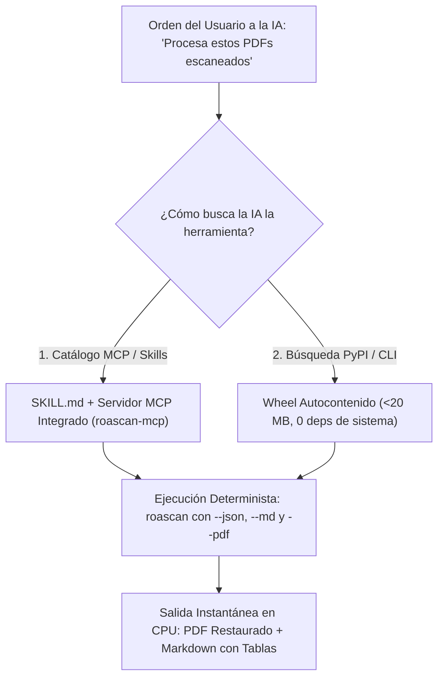

# Hoja de Ruta Estratégica 2026: RoaScan (`roascan`)

---

## 1. Propuesta de Valor ("El SQLite / llama.cpp del OCR Documental")

> **"RoaScan es el motor C++17 + ONNX ultraligero (< 20 MB, 100% CPU, 0 dependencias externas del sistema) diseñado para recibir PDFs/TIFFs escaneados multipágina y producir instantáneamente un PDF restaurado de alta compresión con capa de búsqueda (`Ctrl+F`) o un Markdown (`.md`) con tablas y estructura semántica listo para Agentes de IA."**

---

## 2. Arquitectura *Agent-First*

---

## 3. Estado de Hitos Técnicos (2026)

### ✅ Fase 1–3: Núcleo C++17, Aceleración ONNX, Empaquetado `pip install` y Servidor MCP (Completadas)
- [x] **Núcleo C++17 (`roascan-native` / `roascan_core.dll`):** Binarización Sauvola 64-bit, Deskew *Coarse-to-Fine* (`1.96 ms` en A4, precisión `0.1°`), rotación bilineal sincronizada, segmentación `XY-Cut` multicolumna y Trie Levenshtein incremental.
- [x] **Reconocimiento ONNX por línea (`RoaScanTextRecognizer`):** Decodificación CTC con alineación espacial de *timesteps* a cajas de palabras (`roascan_rec_latin_v5.onnx`).
- [x] **Restauración Morfológica en Español (`AccentRestorer`):** Diccionario Hunspell con expansión de afijos `/G` y `/S` y preservación de puntuación.
- [x] **Restauración Visual Documental en C++ (`roascan_native_enhance_document`):** Blanqueo adaptativo de papel + preservación de bordes *anti-aliased* de 1px, logrando PDFs buscables hasta **20x más livianos**.
- [x] **Reconstrucción Semántica de Markdown (`.md`):** Detección automática de títulos `#`/`##`, pares clave-valor y tablas Markdown (`|---|---|`).
- [x] **Empaquetado `pip install` y Servidor MCP (`roascan-mcp`):** `pyproject.toml` en la raíz del repositorio, comandos globales `roascan` y `roascan-mcp`, y archivos de descubrimiento `SKILL.md` y `mcp_config.json`.

### ✅ Fase 4: Escalamiento Multipágina Extremo y Precisión en Formularios (Completada)
- [x] **Detección y Eliminación de Líneas de Grilla (`roascan_native_remove_grid_lines` en C++):** Borra líneas horizontales y verticales de recuadros de tablas preservando los trazos de letras que las cruzan, evitando que bordes verticales se lean como `I`/`1`/`l` y manteniendo las líneas visuales en el PDF final.
- [x] **Auto-Orientación Ortogonal (`90° / 180° / 270°` en C++ + Sondeo ONNX):** Detecta páginas escaneadas de costado (`roascan_native_detect_sideways`) o boca abajo (`180°`) y las rota sin pérdida (`roascan_native_rotate_orthogonal`) antes del reconocimiento.
- [x] **Procesamiento Multipágina Paralelo (`ThreadPoolExecutor` Multicore Pool):** Procesa páginas de PDFs multipágina en paralelo entre los núcleos de la CPU en [`roascan/engine.py`](file:///d:/APLICATIVOS/ROA%20OCR/roascan/engine.py).
- [x] **CI/CD Multiplataforma y Licencia (`Apache-2.0`):** Incluidos [`LICENSE`](file:///d:/APLICATIVOS/ROA%20OCR/LICENSE) y [`.github/workflows/ci-release.yml`](file:///d:/APLICATIVOS/ROA%20OCR/.github/workflows/ci-release.yml) para compilación automática en Windows, Linux y macOS.
